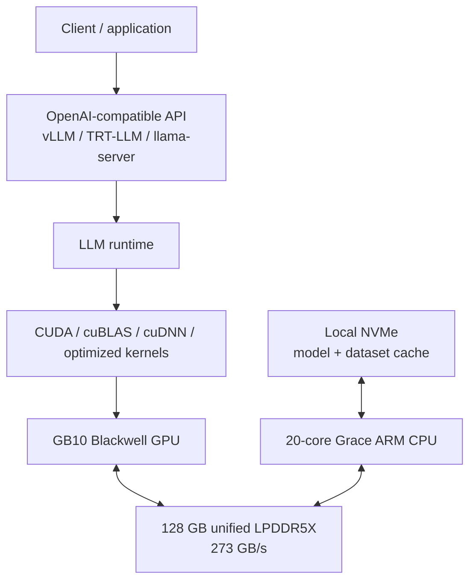
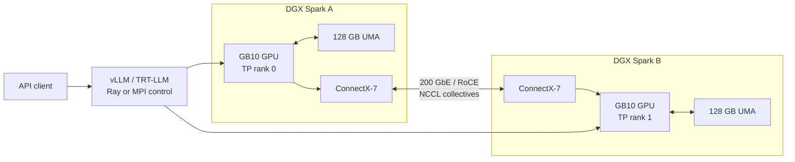
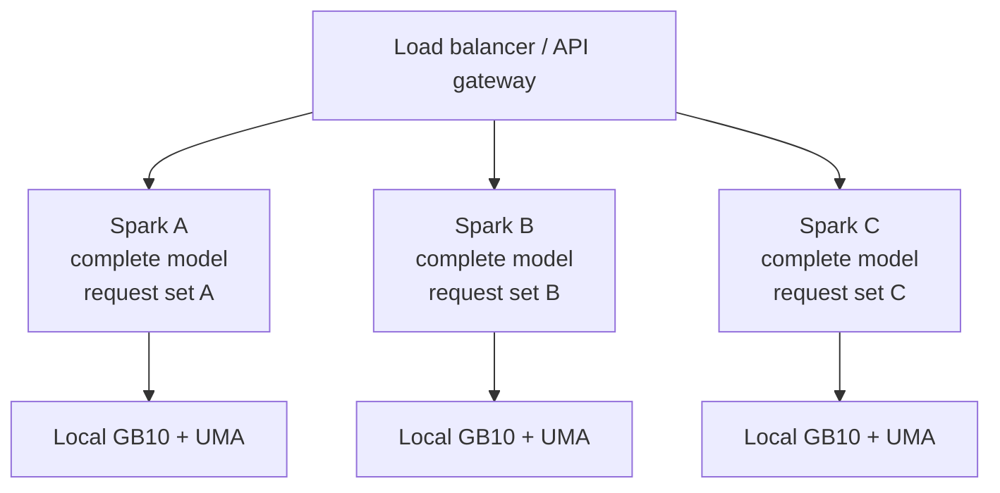
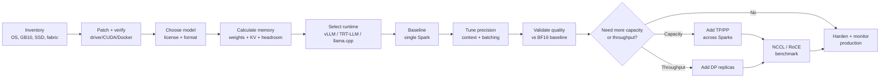

> Verbatim first prompt of the pgx-research session (record `21b2747c-95d0-475c-9c4f-ad4f9a5b3202`, 2026-09-28T10:45:25.070Z), including the pasted DGX Spark research.

analyze the below documents and lets brainstorm a way to create a new ploinky agent similar to local-llms/local-llm-agent called dgx-local-agent that will be running local ai models in a way optimized for this machine
feel free to clone any repos for github.com/assistos-ai like the AchillesIDE and all of its dependecies in order to analyze them and come up with a plan
 
# Running Local LLMs on NVIDIA DGX Spark: Architecture, Frameworks, Scaling, and Production Deployment

## Executive summary

As of September 28, 2026, NVIDIA DGX Spark is best understood **not as a miniature DGX H100/H200**, but as a different class of machine: a compact ARM64 Grace Blackwell system with **one integrated GB10 Blackwell GPU, 128 GB of CPU/GPU-coherent LPDDR5X unified memory, 273 GB/s memory bandwidth, and high-speed ConnectX-7 Ethernet/RoCE networking**. Its defining advantage for local LLMs is unusually large coherent memory capacity for a desktop-scale system; its principal limitation is that this memory is far slower than datacenter HBM. NVIDIA specifies up to 200B-model support on one Spark and selected 405B-class operation with two Sparks, but these figures should be interpreted as model-capacity claims, not guarantees of high token throughput at arbitrary context lengths. citeturn22search6turn22search3

The most important architectural fact is that **each DGX Spark contains only one GPU**. Therefore, conventional “multi-GPU DGX” advice does not map directly to Spark: tensor parallelism, pipeline parallelism, ZeRO/FSDP across GPUs, and similar techniques become **multi-node strategies when applied across Sparks**. Multi-node communication traverses ConnectX-7 rather than NVLink/NVSwitch. Each Spark exposes two QSFP ports, each up to 200 Gb/s, and those ports are explicitly **Ethernet-only**; RoCE can provide RDMA semantics, but this is not native InfiniBand link-layer networking. NVIDIA's current Cluster Assistant supports up to three directly connected systems and up to four systems with a switch. citeturn18search0turn18search15

My overall recommendations are:

| Workload | Recommended first choice | Why |
|---|---|---|
| Interactive/local GGUF inference | **llama.cpp + GGUF** | Simplest stack, NVIDIA has a current Spark-specific playbook, excellent aggressive quantization support, no Python serving stack required. citeturn15search2turn15search10 |
| General OpenAI-compatible production inference | **vLLM in a Spark-validated container** | Paged KV management, continuous batching, OpenAI API, current NVIDIA Spark playbook, Ray-based multi-Spark support. citeturn19search1turn22search11 |
| Maximum NVIDIA-specific inference optimization | **TensorRT-LLM**, optionally behind Triton | Strongest Blackwell-specific FP8/NVFP4 path, optimized kernels, model parallelism and Triton integration. citeturn19search2turn16search1 |
| <=70B fine-tuning | **PyTorch + Hugging Face + PEFT/QLoRA**, BF16 compute | Much more practical than full-parameter training; QLoRA substantially reduces parameter memory. citeturn7search2turn4search3 |
| Distributed training | **Megatron Core/NeMo or DeepSpeed** | TP/PP/CP/FSDP and ZeRO are designed for distributed model-state management. citeturn21search0turn21search1 |
| Legacy FasterTransformer workloads | **Migrate to TensorRT-LLM** | NVIDIA has ended active FasterTransformer development and explicitly directs users to TensorRT-LLM. citeturn21search2turn21search6 |

For one Spark, the best strategy is almost always **avoid distributed complexity, quantize enough to leave substantial KV-cache/runtime headroom, and keep the whole model local**. For two Sparks, use TP=2 only when necessary to make the model fit or when a Spark-specific recipe demonstrates a benefit. Cross-node tensor parallelism performs collectives in the decode path, so aggressively increasing TP can turn the 200 Gb/s network into the bottleneck. For throughput scaling of models that already fit one Spark, **independent data-parallel serving replicas are usually architecturally preferable to cross-node TP** because each request stays local. This recommendation follows directly from Spark's one-GPU-per-node design, its 273 GB/s local-memory bandwidth, and its network topology. citeturn22search6turn18search0turn21search1

For precision, **BF16 is the default training compute format I would start with**; for inference, FP8/NVFP4 are compelling when TensorRT-LLM or another validated Blackwell path supports the model, while AWQ/GPTQ/GGUF 4-bit quantization is attractive for capacity and portability. INT8 is a conservative intermediate choice. Two- and three-bit GGUF quantization should be treated as a capacity-first option requiring model-specific quality testing rather than as the default performance setting. TensorRT-LLM currently exposes FP8, FP4/NVFP4, GPTQ/AWQ 4-bit, and quantized KV-cache options, while GGUF defines numerous 2-, 3-, 4-, 5-, 6- and 8-bit formats. citeturn8search0turn20search1

A final practical warning: Spark's unified memory changes several familiar CUDA operational assumptions. `nvidia-smi` does not report conventional GPU `Memory-Usage` on this iGPU platform, and CUDA's free-memory reporting can understate what the system can eventually allocate because reclaimable/swappable system memory is not represented in the same way as discrete-GPU VRAM. Capacity monitoring should therefore include Linux system memory, swap, process RSS, and application/runtime metrics rather than depending on one CUDA number. NVIDIA has continued improving Spark unified-memory out-of-memory handling through its 2026 DGX OS releases. citeturn2view0turn2view1

## Platform inventory and assumptions

The report assumes an **NVIDIA Founders Edition DGX Spark running the current NVIDIA-supported DGX OS stack as of September 2026**. Partner GB10 systems can differ in firmware, release cadence, SSD capacity and software validation, so a partner appliance should be checked independently. NVIDIA's September 2026 documentation lists DGX OS 7.5.0; recent Spark release notes also describe updated cluster/NCCL support. citeturn18search15turn14search1

| Component | DGX Spark inventory | Operational implication |
|---|---|---|
| SoC | NVIDIA GB10 Grace Blackwell | Integrated CPU/GPU rather than PCIe-attached discrete GPU. citeturn22search6 |
| GPU | Blackwell, 5th-gen Tensor Cores, 6,144 CUDA cores | Supports modern low precision; GB10 CUDA compute capability is 12.1 / `sm_121`. citeturn22search6turn9search1 |
| GPU count | **1 integrated GPU per Spark** | Multi-GPU algorithms across Sparks become multi-node algorithms. citeturn22search6 |
| CPU | 20-core Arm: 10 Cortex-X925 + 10 Cortex-A725 | Native platform is ARM64/AArch64; x86-only wheels/containers cannot be assumed compatible. citeturn22search6turn9search0 |
| Memory | 128 GB LPDDR5X unified CPU/GPU memory | Large capacity, but OS, CPU workloads, weights, KV cache, CUDA workspaces and applications share the same pool. citeturn22search6turn9search0 |
| Memory bandwidth | 273 GB/s | Much lower than HBM datacenter accelerators; token decoding can become bandwidth-sensitive. NVIDIA's own cuTile comparison shows a substantial HBM advantage for B300 on memory-bound kernels. citeturn22search3turn22search6 |
| Local storage | 1 TB or 4 TB NVMe M.2, self-encrypting | Good target for model cache, datasets and NVMe offload; actual installed capacity is **unspecified in the question**. citeturn22search6 |
| Management Ethernet | 10 GbE RJ-45 | Appropriate for SSH/API/admin traffic, not preferred for distributed tensor traffic. citeturn22search6 |
| Cluster fabric | 2 × ConnectX-7 QSFP ports, each up to 200 Gb/s | Use for Spark-to-Spark traffic. Ports are Ethernet-only and can carry RoCE. citeturn18search0 |
| Wireless | Wi-Fi 7, Bluetooth 5.4 | Convenient management connectivity; normally disable or isolate it in tightly controlled deployments. citeturn22search6 |
| Power | 240 W external PSU; GB10 SoC TDP 140 W | Useful for TCO/energy measurements; supplied PSU is required for optimal operation. citeturn22search6 |
| OS | DGX OS, Ubuntu 24.04 base, ARM64 | Prefer ARM64 NVIDIA containers rather than manually assembling x86-centric Python environments. citeturn9search0turn14search8 |
| Container runtime | Docker + NVIDIA Container Toolkit preconfigured | This should be the default software isolation mechanism on Spark. citeturn14search2 |
| CUDA | Current Spark release uses CUDA 13-era software; September release stack is DGX OS 7.5.0 | Pin containers to Spark-tested CUDA/framework combinations rather than assuming arbitrary wheels understand `sm_121`. citeturn2view1turn18search15 |

A useful conceptual topology is:



This topology matters because “CPU offload” on Spark is fundamentally different from CPU offload on a PCIe GPU server: there is **not a second large pool of host DRAM in addition to GPU VRAM**. CPU and GPU consume the same 128 GB physical unified-memory pool. CPU offload may alter placement or compute behavior, but it does not magically turn 128 GB into 128 GB GPU + 128 GB CPU memory. NVMe offload, by contrast, actually extends backing capacity beyond DRAM, at much lower bandwidth and much higher latency. This is an architectural inference from NVIDIA's unified-memory design and DeepSpeed's CPU/NVMe offload semantics. citeturn9search0turn21search8

The following items are **unspecified by the question and should not be silently assumed**: number of Spark nodes; 1 TB versus 4 TB SSD configuration; presence and model of a 200/400 GbE switch; whether RoCE/PFC/ECN is configured by the site; model architecture; target context window; expected concurrency; training versus inference mix; required SLA; shared storage; NFS/Lustre/GPFS availability; internet versus air-gapped operation; model license; security classification; and electricity/hardware acquisition cost. NVIDIA's current software supports enterprise/cloud-init and air-gapped-oriented provisioning workflows, but those need site-specific design. citeturn14search11

## Frameworks, model formats, and runtime choices

The core compatibility question is not merely “does the framework support CUDA?” It is **does the exact ARM64 build contain kernels and dependencies for GB10 `sm_121`, CUDA 13-era drivers, and Spark's UMA behavior?** NVIDIA explicitly recommends its current NGC/Spark recipes because Spark is sufficiently new that generic upstream wheels can lag architecture support. citeturn14search9turn9search0

| Framework/runtime | Spark assessment | GPU utilization potential | Ease | Strengths | Weaknesses / caveats | Best use |
|---|---|---:|---:|---|---|---|
| **PyTorch + Hugging Face Transformers** | First-class general development stack | High with optimized attention/compiled kernels | High | Broadest model ecosystem; training/fine-tuning; safetensors; AMP | Raw eager inference usually loses to specialized servers | Research, fine-tuning, custom model code. NVIDIA lists PyTorch among Spark framework targets. citeturn22search6turn20search17 |
| **TensorRT-LLM** | **Excellent / preferred NVIDIA inference stack** | Very high | Medium | Blackwell-oriented kernels, quantization, KV management, TP/PP, direct HF integration | More NVIDIA-specific; best results depend on supported model/quant format | Maximum NVIDIA inference performance. citeturn19search2turn16search5 |
| **vLLM** | **Excellent**; official Spark playbook | High to very high | High | PagedAttention, continuous batching, OpenAI API, Ray multi-node | Architecture/container compatibility matters; use Spark-tested recipes | General serving, multi-user APIs. citeturn19search1turn19search4 |
| **llama.cpp / GGML** | **Excellent for GGUF**; official Spark playbook | Medium to high, workload-dependent | Very high | Lightweight; CUDA build; GGUF; 2–8 bit ecosystem; minimal dependencies | Less suited to large distributed training; throughput-oriented batching differs from vLLM | Local assistants, edge-style serving, aggressive quantization. citeturn15search2turn15search10 |
| **Triton Inference Server** | Good serving/control plane | Backend-dependent | Medium | Metrics, dynamic/in-flight batching, standardized HTTP/gRPC, TensorRT-LLM backend | Adds another layer for one-user local inference | Managed multi-model production service. citeturn16search1turn16search4 |
| **DeepSpeed** | Strong training tool; Spark-specific value mainly multi-node | High when workload scales well | Medium-low | ZeRO-1/2/3, CPU/NVMe offload, distributed training | Single Spark has only one GPU, and CPU offload does not create a second DRAM pool under UMA | Multi-Spark training or memory-heavy optimizer state. citeturn21search0turn21search8 |
| **Megatron Core / Megatron-LM** | Strong for distributed training | Very high at sufficient scale | Low | TP, PP, DP, CP, EP, distributed optimizer/FSDP | Considerable complexity for a 1–4-node desktop cluster | Large-model pretraining/fine-tuning research. citeturn21search1 |
| **FasterTransformer** | **Legacy; do not start new Spark deployments with it** | Historically high | Low | CUDA/cuBLAS-based optimized Transformer kernels | NVIDIA ended development and directs users to TensorRT-LLM; predates GB10 | Maintaining an existing FT deployment long enough to migrate. citeturn21search2turn21search6 |
| **ONNX Runtime CUDA EP** | Technically viable, but not a first-choice LLM path | Medium-high where graph is well supported | Medium | Framework-neutral graph, CUDA EP, CUDA 13 support in current ORT | ARM64+CUDA packaging for the exact Spark environment must be validated; LLM ecosystem less direct than vLLM/TRT-LLM | Existing ONNX production models. citeturn16search2turn16search6 |
| **TensorFlow** | Possible, but **not my recommended Spark LLM stack** | Potentially high | Low-medium on Spark | Mature framework and SavedModel ecosystem | Official upstream ARM64 pip distribution is primarily CPU-focused; GPU ARM64 deployment may require container/source validation | Existing TensorFlow applications, not greenfield LLM serving. citeturn16search3turn16search7 |

TensorFlow deserves particular caution. Current TensorFlow documentation notes that Linux AArch64 pip packages are supplied through AWS's CPU-oriented package arrangement; that is not equivalent to a first-class, Spark-validated CUDA/GB10 wheel. If TensorFlow is mandatory, I would first search NGC for a current ARM64/CUDA build validated against the installed Spark release rather than attempting `pip install tensorflow[and-cuda]` and assuming the x86 path applies. citeturn16search3turn14search9

ONNX is more promising as an interchange/deployment format because current ONNX Runtime exposes a CUDA Execution Provider with CUDA 13 builds and documents ARM builds, but the exact combination of ARM64 Python wheel, CUDA EP, `sm_121` kernels and all operators used by a modern decoder LLM still needs validation. ONNX is therefore sensible for an existing ONNX estate, not the path I would choose merely because Spark can theoretically run it. citeturn16search2turn16search6

**Model-format compatibility is equally important:**

| Format | Typical runtimes | Spark recommendation | Notes |
|---|---|---|---|
| **Hugging Face safetensors** | Transformers, PyTorch, vLLM, TensorRT-LLM import paths | **Preferred source checkpoint format** | Safer tensor serialization than pickle and supports sharded/partial tensor loading. citeturn20search2turn20search17 |
| PyTorch checkpoint / `state_dict` | PyTorch, HF | Good for development | Pickle-based legacy checkpoints warrant more supply-chain caution than safetensors. HF increasingly prefers safetensors. citeturn20search4turn20search20 |
| **GGUF** | llama.cpp / GGML executors | **Preferred lightweight/local format** | Successor to legacy GGML/GGMF/GGJT formats; designed as a self-describing inference format and supports many quantization types. citeturn20search1turn20search0 |
| Legacy GGML-format model files | Old GGML/llama.cpp versions | Avoid for new deployments | GGUF superseded legacy GGML-family model formats. citeturn20search1 |
| ONNX `ModelProto` | ONNX Runtime, Triton ONNX backend | Situational | Portable graph/intermediate representation; operator/version compatibility still matters. citeturn20search13turn20search32 |
| TensorRT-LLM optimized checkpoint/engine artifacts | TensorRT-LLM/Triton | **Excellent where validated** | Best when using a Spark-supported model/precision recipe; optimized artifacts are less portable than HF/GGUF source checkpoints. citeturn19search2turn16search1 |
| TensorFlow SavedModel | TensorFlow/Triton TF backend where supported | Legacy/situational | SavedModel serializes TensorFlow computation and assets; not the preferred LLM ecosystem on Spark. citeturn20search29turn20search43 |

A crucial update for anyone following older DGX tutorials is that **FasterTransformer should now be considered historical compatibility technology**. Its repository explicitly states that development moved to TensorRT-LLM and that FasterTransformer will not receive further development. On a brand-new GB10 `sm_121` platform, deliberately adopting that frozen stack creates unnecessary kernel, CUDA and ARM64 compatibility risk. citeturn21search2turn21search6

Research from the 2022–2026 period reinforces the runtime choices. The vLLM/PagedAttention paper reported roughly 2–4× throughput improvements over its tested serving baselines at comparable latency by addressing KV-memory fragmentation; AWQ showed practical 4-bit weight-only inference with strong quality retention and large speedups on the devices it evaluated; QLoRA demonstrated 4-bit NF4 training of a 65B model on a single 48 GB GPU in its experimental setup; and FlashAttention-2 substantially improved attention efficiency on its tested accelerators. These results are **not Spark benchmark numbers**, but their architectural ideas—efficient KV allocation, low-bit weights and fused/memory-efficient attention—are precisely relevant to Spark's capacity-rich but bandwidth-constrained design. citeturn7search0turn7search1turn7search2turn7search3

## Parallelism, memory, and performance engineering

The key to Spark performance is first making the model fit with **healthy memory headroom**, then minimizing communication and memory traffic. Raw weight-size arithmetic illustrates why:

| Parameter count | BF16 / FP16 weights | 8-bit weights | 4-bit weights | Interpretation on 128 GB Spark |
|---:|---:|---:|---:|---|
| 7B | ~14 GB | ~7 GB | ~3.5 GB | Comfortable in essentially every useful precision |
| 30B | ~60 GB | ~30 GB | ~15 GB | BF16 possible for inference with limited context/concurrency |
| 70B | ~140 GB | ~70 GB | ~35 GB | BF16 weights alone exceed physical memory; quantization required on one Spark |
| 120B | ~240 GB | ~120 GB | ~60 GB | 8-bit is practically too tight; 4-bit is much more realistic |
| 200B | ~400 GB | ~200 GB | ~100 GB | 4-bit weights theoretically fit but leave little headroom |
| 405B | ~810 GB | ~405 GB | ~202.5 GB | Requires multiple Sparks at 4-bit-class storage |

These are mathematical lower bounds, **not runtime footprints**. They exclude quantization scales/metadata, temporary tensors, CUDA/runtime workspaces, tokenizer/application memory, KV cache, activations, OS memory and fragmentation. This is why NVIDIA's “up to 200B on one Spark / 405B on two” claim should not be translated into “every 200B model runs with a large context on one Spark.” citeturn22search6

**Parallelism strategy on Spark should be chosen in this order:**

| Technique | What is partitioned | Spark recommendation |
|---|---|---|
| Data parallelism | Requests/batches; full model per node | Best scale-out choice when model fits on every Spark. Ideal for aggregate serving throughput. Megatron defines DP as replication across ranks. citeturn21search1 |
| Tensor parallelism | Matrix/tensor dimensions inside each layer | Use only when model cannot fit one Spark or a validated runtime recipe shows benefit. TP communicates frequently and therefore exposes the cross-node fabric. citeturn21search1turn17search7 |
| Pipeline parallelism | Groups of Transformer layers | Useful for deep models/training; less collective-heavy than TP but introduces stage imbalance and pipeline bubbles. citeturn21search1 |
| ZeRO-1 | Optimizer states | Training only; useful when optimizer state is dominant. citeturn21search0 |
| ZeRO-2 | Optimizer states + gradients | Good multi-Spark training compromise if parameters fit each rank. citeturn21search0 |
| ZeRO-3 / FSDP full shard | Parameters + gradients + optimizer states | Use when full training state does not fit per Spark; incurs substantially more communication. citeturn21search0turn21search9 |
| Context parallelism | Sequence dimension | Mainly long-context training; Megatron recommends it for long sequences and activation-memory pressure. citeturn21search1 |
| Expert parallelism | MoE experts | Appropriate for large MoE architectures, not dense-model serving by default. citeturn21search1 |

For inference, **TP across two Sparks is principally a capacity tool**. vLLM can use Ray for cross-node TP/PP, and NVIDIA's current Spark playbook explicitly provides multi-node vLLM operation over QSFP. Ray also supports cross-node TP and PP and manages placement groups across nodes. citeturn19search1turn17search7



Conversely, when a 7B/30B/70B quantized model fits independently on every Spark, a data-parallel serving topology is generally more attractive:



That design removes per-token inter-node synchronization and lets the high-speed fabric carry request/control/model-distribution traffic rather than every layer's collectives. It does require one complete copy of the model per Spark. This is an architectural recommendation, consistent with how DP and TP divide work. citeturn21search1turn17search7

**Precision and quantization.** For training, I would start with BF16 autocast/AMP rather than FP32; use FP32 only where numerically required. For inference, evaluate in roughly this order: BF16 baseline → FP8 → NVFP4/AWQ/GPTQ 4-bit → specialized 3-/2-bit GGUF only if memory capacity still dominates. TensorRT-LLM's current quantization stack covers FP8, FP4/NVFP4 and AWQ/GPTQ-style low-bit paths; GGUF offers `Q2`, `Q3`, `Q4`, `Q5`, `Q6`, `Q8`, IQ/TQ and BF16 representations. citeturn8search0turn20search1

For QLoRA-style fine-tuning, NF4 4-bit base weights plus BF16 compute are a sensible starting point. Hugging Face's bitsandbytes integration documents NF4, double quantization and 4-/8-bit loading, while the QLoRA paper introduced NF4 and paged optimizer techniques for memory-efficient fine-tuning. On Spark, however, verify the particular ARM64/`sm_121` bitsandbytes build rather than assuming an arbitrary PyPI binary is appropriate. citeturn4search3turn7search2

**Kernel stack.** At the low level, cuBLAS/cuBLASLt supplies GEMM primitives and current narrow-precision support; cuDNN includes optimized attention paths based on modern FlashAttention algorithms and paged attention; CUTLASS exposes lower-level templates for Blackwell matrix kernels. In normal LLM deployments I would **not hand-tune CUTLASS first**: choose a framework whose Spark build already selects optimized kernels, then profile with Nsight and only descend to CUTLASS/cuTile when profiling identifies a real unsupported hotspot. citeturn8search1turn8search2turn8search3

NVIDIA's 2026 cuTile Spark benchmark is useful context: in its specific Qwen2-7B experiment DGX Spark achieved 18.52 tokens/s versus 257.33 on B300, while memory-bound kernels showed particularly large differences attributable to B300's 8 TB/s HBM versus Spark's 273 GB/s LPDDR5X. Those figures are workload-specific and should not be generalized to all LLMs, but they demonstrate why **bandwidth efficiency, quantization and batching matter at least as much as theoretical FP4 TOPS on Spark**. citeturn22search3

**Memory optimization should follow this hierarchy:** quantize weights; reduce maximum context; control concurrency/KV cache; use paged KV management; enable gradient/activation checkpointing for training; use LoRA/QLoRA instead of full fine-tuning; shard across Sparks if needed; and only then introduce NVMe offload. DeepSpeed can offload parameters/optimizer state to NVMe in ZeRO-3, but offload trades memory pressure for I/O and should use local NVMe, not a latency-sensitive shared filesystem. citeturn21search8turn21search0

For single-Spark training, classic activation checkpointing is especially useful because it trades extra forward recomputation for reduced saved-activation memory. For multi-Spark Megatron training, checkpointing can be combined with TP/PP/CP/FSDP. NVIDIA's Megatron guidance explicitly places activation checkpointing/offloading among the tools for extreme memory constraints. citeturn21search1

## Networking, orchestration, storage, and security

Spark networking is easy to misunderstand because NCCL retains names such as `NCCL_IB_HCA` even when the actual network is **RoCE over Ethernet**. NVIDIA's Spark documentation explicitly says QSFP supports Ethernet configuration only, while NCCL documentation describes its Verbs/"IB" transport as applying to IB/RoCE. Therefore, “InfiniBand tuning” on Spark really means **ConnectX-7 Ethernet/RoCE + NCCL/UCX tuning**, not configuring an InfiniBand subnet. citeturn18search0turn18search1turn18search7

Useful diagnostic/configuration variables include:

```bash
# Discover mappings first; do not blindly copy interface names.
ibdev2netdev

# Select the high-speed data interface rather than 10GbE/Wi-Fi.
export NCCL_SOCKET_IFNAME=<spark-high-speed-interface>

# Restrict NCCL's RDMA/Verbs path to the intended ConnectX interface(s).
export NCCL_IB_HCA=<mlx5-device-list>

# Useful during bring-up only; avoid leaving verbose debug enabled forever.
export NCCL_DEBUG=INFO
export NCCL_DEBUG_SUBSYS=INIT,NET

# Run your distributed application or nccl-tests afterward.
```

NCCL warns that interface overrides bypass automatic selection and that debug/workaround variables can themselves create suboptimal configurations if left enabled indiscriminately. RoCE-specific settings such as GID/version and traffic class should match the actual switch/VLAN/PFC/ECN design rather than being copied from generic InfiniBand tuning guides. citeturn18search1turn18search5

For a two-node installation, direct QSFP cabling is simplest. NVIDIA Sync can configure high-speed interfaces and passwordless SSH and validate the cluster network, but it explicitly **does not configure vLLM, NCCL, Slurm, Kubernetes or other workload runtimes**. NVIDIA's current cluster tooling covers up to three Sparks without a switch and four with a switch. citeturn18search15turn18search21

**Orchestration comparison:**

| Runtime/orchestrator | Maturity | Ease on Spark | GPU-utilization effect | Advantages | Disadvantages | Recommended use |
|---|---|---:|---:|---|---|---|
| **Docker / Compose** | Very high | **Highest** | Neutral | NVIDIA Container Toolkit is preinstalled; simplest reproducibility | Weak scheduling/failover | Default for one Spark and small fixed clusters. citeturn14search2 |
| **Ray** | High | High | High for supported serving patterns | vLLM/Ray cross-node TP/PP; placement groups; scalable API workers | Additional control-plane components | **Preferred distributed vLLM control plane**. citeturn17search7turn19search1 |
| **Slurm** | Very high in HPC | Medium | Neutral/high | GPU GRES scheduling, MPI integration, quotas/accounting | Administration overhead for a tiny cluster | Multi-user training/research clusters. citeturn17search1turn17search9 |
| **Kubernetes + GPU Operator** | Very high | Low-medium | Neutral; depends on workload | Declarative services, restart policy, RBAC, monitoring, fleet integration | Considerable complexity for 1–4 nodes; Spark-specific production validation must be checked | Existing Kubernetes organizations, multi-service deployments. GPU Operator automates drivers/toolkit/device plugin/DCGM in supported clusters. citeturn17search8turn17search0 |
| **Apptainer / Singularity-style containers** | High in HPC | Medium | Neutral | Non-root HPC workflows; NVIDIA CUDA device support | Less convenient for API-service stacks than Docker; exact SingularityCE Spark validation is unspecified | Slurm/HPC environments. citeturn17search2turn17search6 |
| **MPI / HPC-X / UCX** | Very high | Low as an app UX | Can be excellent | CUDA-aware communication, used by TensorRT-LLM distributed backends | Communication/launch layer, not a service orchestrator | TensorRT-LLM, Megatron and scientific distributed workloads. citeturn18search23turn16search1 |
| **Triton Inference Server** | Very high | Medium | High if batching/backend tuned | Model repository, HTTP/gRPC, metrics, TensorRT-LLM backend | Unnecessary layer for simple personal inference | Multi-model managed serving. citeturn16search1turn16search4 |

For a four-Spark lab, I would choose **Docker + Ray for inference**, or **Docker/Apptainer + Slurm for research training**. I would introduce Kubernetes only if Kubernetes provides organizational benefits beyond merely “running the model.” A four-node Spark installation is small enough that Kubernetes can easily become more operational work than the inference stack itself. This is a recommendation based on Spark's validated cluster scale and the responsibilities of the respective orchestration layers. citeturn18search15turn17search8

**Storage design should be deliberately local-first.** Put active model checkpoints, tokenizer files, TensorRT compilation artifacts, Hugging Face cache, llama.cpp GGUF files and DeepSpeed NVMe offload on the local NVMe SSD. The current Spark hardware offers either 1 TB or 4 TB local self-encrypting NVMe; model repositories can consume hundreds of gigabytes surprisingly quickly when multiple BF16, FP8 and 4-bit variants are retained. citeturn22search6turn15search4

For a cluster, NFS is adequate for source datasets, experiment outputs and checkpoint distribution when throughput requirements are modest, but I would stage frequently used model weights from NFS to local NVMe before service startup. Lustre and IBM Storage Scale/GPFS can make sense in an existing HPC site, but **current DGX Spark documentation does not define either as an integrated Spark storage architecture**, so ARM64 client packages and compatibility with the exact DGX OS/kernel release must be validated by the storage vendor. The same caution applies to parallel filesystems generally. citeturn14search1

A sensible model-data hierarchy is therefore:

```text
Object/archive/NAS/Lustre/GPFS
        │
        │ stage or synchronize
        ▼
local NVMe
  ├── HF cache
  ├── GGUF models
  ├── TRT-LLM artifacts
  ├── datasets/shards
  └── DeepSpeed NVMe offload
        │
        ▼
128 GB UMA
  ├── active weights
  ├── KV cache
  ├── activations
  ├── CUDA workspace
  └── CPU/application state
```

**Security is not optional simply because the server is “local.”** DGX Spark supports Secure Boot and allows Wi-Fi/Bluetooth to be disabled through firmware configuration; its SSD is self-encrypting. NVIDIA also supports customized provisioning and local repository workflows suitable for controlled environments. citeturn11search4turn14search11turn22search6

For multi-node security, the high-speed RoCE fabric should be treated as a trusted backend network. NCCL documentation explicitly notes that NCCL does not itself encrypt several high-speed transports, including RDMA paths; isolation therefore needs to come from physical/network segmentation and surrounding security controls. citeturn18search11

Never bake Hugging Face, NGC or model-repository credentials into container images. Prefer short-lived/environment-injected secrets or owner-readable mounted secret files and clear them after model acquisition. NVIDIA's newer local-inference guidance similarly uses private credential files and isolated internal networks for hardened local serving. citeturn15search9

Licensing has three independent layers: NVIDIA software/container terms, orchestration/framework licenses, and **the model's own license**. Access to a NIM container is not identical to holding an NVIDIA AI Enterprise entitlement; NVIDIA explicitly distinguishes free/developer NIM access from paid enterprise software/support entitlement. Hugging Face gated repositories can additionally require individual approval and acceptance of model-owner terms. citeturn14search4turn11search3

## Deployment recipes, monitoring, and validation

A reliable deployment process should proceed through explicit gates rather than “download a 200B checkpoint and see if it starts.”



A practical deployment checklist is:

| Gate | Validation |
|---|---|
| Hardware | Confirm Spark model/SKU, SSD free space, cooling and supplied 240 W PSU. citeturn22search6 |
| OS | Confirm current DGX OS/driver/firmware and reboot after required platform updates. citeturn18search15turn22search5 |
| CUDA | `nvidia-smi`, `nvcc --version`, and a CUDA container smoke test. Container Toolkit is supplied on Spark. citeturn14search2 |
| ARM64 | Verify every native extension/container has AArch64 plus `sm_121` support; compile CUDA code for architecture 12.1 when needed. citeturn9search0turn9search1 |
| Model | Review license, checksum/provenance, architecture and context requirements. Prefer safetensors or GGUF over untrusted pickle serialization. citeturn20search4turn11search3 |
| Capacity | Estimate weights + KV + runtime and reserve system headroom; do not treat 128 GB as entirely available to CUDA. citeturn2view0turn22search6 |
| Single-node baseline | Benchmark before adding clustering. |
| Network | For multiple Sparks, run NVIDIA Sync/network validation and NCCL tests before the LLM. citeturn18search21turn6search4 |
| Quality | Compare quantized and baseline responses on representative held-out evaluations. |
| Performance | Record TTFT, inter-token latency, throughput, concurrency, memory, power and failures under sustained load. NVIDIA recommends these classes of metrics for generative-serving benchmarking. citeturn12search1 |
| Hardening | Bind API only to required interfaces, protect credentials, isolate RoCE, establish model/API authentication and update policy. citeturn18search11 |

**Basic platform smoke test**

NVIDIA documents the GPU-enabled Docker path directly on Spark. citeturn14search2

```bash
uname -m
# Expect: aarch64

nvidia-smi
nvcc --version

docker run --rm --gpus all \
  nvcr.io/nvidia/cuda:13.0.1-devel-ubuntu24.04 \
  nvidia-smi

free -h
df -h
```

Do not reject the system merely because `nvidia-smi` displays `Memory-Usage: Not Supported`; this is a documented Spark/iGPU behavior. Check Linux memory and per-process behavior as well. citeturn2view0

**vLLM on one DGX Spark**

NVIDIA's August 2026 Spark playbook recommends a containerized vLLM workflow, an OpenAI-compatible endpoint, explicit `--max-model-len`, and initial GPU-memory utilization around 0.8 to leave headroom. NVIDIA maintains hardware-specific recipe selections, so a production deployment should pin the current Spark-tested image rather than blindly track `latest`. citeturn19search1turn19search7

```bash
export HF_TOKEN="hf_..."
export MODEL_HANDLE="Qwen/Qwen3-8B"   # example; use a Spark-validated recipe
export VLLM_IMAGE="<current Spark-validated vLLM image>"
export MAX_MODEL_LEN=8192

mkdir -p "$HOME/.cache/huggingface/hub"

docker run -d \
  --name vllm-server \
  --gpus all \
  --ipc host \
  --ulimit memlock=-1 \
  --ulimit stack=67108864 \
  -p 8000:8000 \
  -e HF_TOKEN="$HF_TOKEN" \
  -v "$HOME/.cache/huggingface/hub:/root/.cache/huggingface/hub" \
  "$VLLM_IMAGE" \
  vllm serve "$MODEL_HANDLE" \
    --max-model-len "$MAX_MODEL_LEN" \
    --gpu-memory-utilization 0.80

docker logs -f vllm-server
```

Validate:

```bash
curl http://localhost:8000/v1/chat/completions \
  -H 'Content-Type: application/json' \
  -d '{
    "model": "'"$MODEL_HANDLE"'",
    "messages": [
      {"role":"user","content":"Explain NUMA versus UMA in three sentences."}
    ],
    "max_tokens": 256
  }'
```

Only increase `--gpu-memory-utilization` toward the upper 0.9s after observing stable system memory, KV growth and concurrent-request behavior. On Spark, vLLM shares physical memory with Linux and the CPU, so a setting appropriate for a dedicated-HBM GPU can be too aggressive. NVIDIA's Spark recipe starts more conservatively for this reason. citeturn19search7

**vLLM across two Sparks**

vLLM supports Ray for distributed inference, and NVIDIA's Spark playbook validates QSFP/Ray multi-node serving. Exact interface names must come from each Spark's ConnectX configuration; do not paste names from another machine. citeturn19search1turn17search7

```bash
# Spark A — head
ray start --head \
  --node-ip-address=<SPARK_A_HIGH_SPEED_IP> \
  --port=6379

# Spark B — worker
ray start \
  --address=<SPARK_A_HIGH_SPEED_IP>:6379 \
  --node-ip-address=<SPARK_B_HIGH_SPEED_IP>
```

Then, from the head environment/container:

```bash
vllm serve "$MODEL_HANDLE" \
  --tensor-parallel-size 2 \
  --distributed-executor-backend ray \
  --max-model-len 8192 \
  --gpu-memory-utilization 0.85
```

For a model that fits one node, benchmark this against **two independent TP=1 replicas** before accepting TP=2. The latter avoids cross-node collectives on every request and can produce higher aggregate serving throughput even though a single request uses only one Spark. vLLM and Ray support both model-parallel and replica-oriented scaling patterns. citeturn17search7turn21search3

**llama.cpp + GGUF**

NVIDIA now maintains a Spark-specific llama.cpp playbook and explicitly builds CUDA kernels for GB10. Its 2026 example uses a quantized Qwen3.6-35B-A3B GGUF and an OpenAI-compatible `llama-server`. citeturn15search2turn15search10

```bash
git clone https://github.com/ggml-org/llama.cpp
cd llama.cpp

cmake -B build \
  -DGGML_CUDA=ON \
  -DCMAKE_CUDA_ARCHITECTURES=121

cmake --build build --config Release \
  --target llama-server -j"$(nproc)"
```

Serve a local GGUF:

```bash
./build/bin/llama-server \
  --model /models/model-Q4_K_M.gguf \
  --n-gpu-layers 999 \
  --ctx-size 8192 \
  --host 0.0.0.0 \
  --port 8000
```

The NVIDIA playbook also shows `GGML_RPC` for distributed llama.cpp use and recommends architecture-specific compilation. For straightforward one-node use, keep the runtime local and only introduce RPC when a model genuinely exceeds one Spark's capacity. citeturn15search2

**Hugging Face + DeepSpeed**

On a single Spark, ZeRO sharding does not buy the usual multi-GPU memory reduction because there is only one rank. The more useful single-node tools are LoRA/QLoRA, BF16, gradient checkpointing and a small micro-batch. ZeRO becomes materially useful once there are multiple Sparks. DeepSpeed defines ZeRO-1 as optimizer sharding, ZeRO-2 as optimizer+gradient sharding, and ZeRO-3 as optimizer+gradient+parameter sharding. citeturn21search0

Example two-Spark ZeRO-2 configuration:

```json
{
  "bf16": {
    "enabled": true
  },
  "train_micro_batch_size_per_gpu": 1,
  "gradient_accumulation_steps": 16,
  "gradient_clipping": 1.0,

  "zero_optimization": {
    "stage": 2,
    "contiguous_gradients": true,
    "overlap_comm": true,
    "reduce_scatter": true
  }
}
```

`hostfile`:

```text
spark-a slots=1
spark-b slots=1
```

Launch:

```bash
deepspeed \
  --hostfile hostfile \
  --master_addr <SPARK_A_HIGH_SPEED_IP> \
  train.py \
  --model_name_or_path <hf-model> \
  --deepspeed ds_zero2.json \
  --bf16 \
  --gradient_checkpointing
```

If parameters themselves no longer fit per rank, move to ZeRO-3. DeepSpeed can additionally offload to NVMe. citeturn21search8

```json
{
  "bf16": {
    "enabled": true
  },
  "zero_optimization": {
    "stage": 3,
    "contiguous_gradients": true,

    "offload_param": {
      "device": "nvme",
      "nvme_path": "/mnt/local-nvme/deepspeed-param"
    },

    "offload_optimizer": {
      "device": "nvme",
      "nvme_path": "/mnt/local-nvme/deepspeed-optim"
    }
  }
}
```

On Spark I would **not use CPU offload merely to “get more memory”** because CPU and GPU share the 128 GB physical pool. NVMe offload actually expands capacity, but the performance penalty can be large; benchmark it rather than assuming that a workload which starts successfully is useful. This is an inference from Spark UMA and DeepSpeed's documented offload design. citeturn9search0turn21search8

**Triton + TensorRT-LLM, and what to do about FasterTransformer**

Current Triton documentation provides a TensorRT-LLM backend with in-flight batching, paged attention, TP/PP and multi-node support. It can also use TensorRT-LLM's newer Python LLM API to load Hugging Face models without the old mandatory engine-build workflow. citeturn16search1turn16search5

A current-style skeleton is:

```bash
export TRITON_TRTLLM_IMAGE="<current ARM64/Spark-compatible tritonserver-trtllm image>"

docker run --rm -it \
  --gpus all \
  --net host \
  --shm-size=2g \
  --ulimit memlock=-1 \
  -v "$HOME/.cache/huggingface:/root/.cache/huggingface" \
  "$TRITON_TRTLLM_IMAGE" \
  bash
```

Inside:

```bash
git clone https://github.com/NVIDIA/TensorRT-LLM.git

# Configure:
# TensorRT-LLM/triton_backend/all_models/llmapi/tensorrt_llm/1/model.yaml
#
# model: <your Hugging Face model or local path>
# plus KV-cache, quantization and parallelism parameters.

python3 TensorRT-LLM/triton_backend/scripts/launch_triton_server.py \
  --model_repo=TensorRT-LLM/triton_backend/all_models/llmapi/
```

NVIDIA's current Triton documentation says to replace its example image tag with the current NGC release; for Spark specifically, I would intersect that advice with the Spark TensorRT-LLM model/support matrix rather than assume every generic Triton release is `sm_121` validated. citeturn16search5turn19search2

For **Triton + FasterTransformer**, the technically honest 2026 configuration is a migration configuration, not a recommended greenfield recipe. NVIDIA states that FasterTransformer is frozen. If an existing FT/Triton repository must temporarily be preserved, isolate it in a pinned legacy image and do not rebuild that image against Spark's current toolchain until compatibility has been established:

```bash
# Legacy-only skeleton — no current NVIDIA GB10 support guarantee.
export FT_TRITON_IMAGE="<your pinned legacy ARM64/FT Triton build>"

docker run --rm \
  --gpus all \
  --net host \
  -v /srv/legacy-ft-model-repository:/models:ro \
  "$FT_TRITON_IMAGE" \
  tritonserver --model-repository=/models
```

I would not fabricate a modern `sm_121` FasterTransformer image tag: NVIDIA does not provide a current development path for it. The supported engineering action is **migrate FT model/configuration to TensorRT-LLM/Triton**. citeturn21search2turn21search6

**Benchmarking and monitoring**

For serving, benchmark at least:

\[
\text{TTFT},\quad
\text{inter-token latency},\quad
\text{end-to-end latency},\quad
\text{output tokens/sec},\quad
\text{requests/sec},\quad
\text{concurrency}
\]

and always report prompt length, generated length, model/quantization, context limit and concurrency with the number. NVIDIA's current serving benchmarking guidance emphasizes TTFT, ITL, TPS/RPS and end-to-end latency; NVIDIA is transitioning newer benchmarking workflows toward AIPerf rather than treating older GenAI-Perf tooling as the long-term default. citeturn12search0turn12search1

For vLLM itself:

```bash
vllm bench serve \
  --backend vllm \
  --base-url http://127.0.0.1:8000 \
  --model "$MODEL_HANDLE"
```

vLLM's current documentation has moved serving benchmarking toward `vllm bench serve`. citeturn12search2

For distributed communication, use `nccl-tests` before blaming the model framework:

```bash
# Representative pattern; exact mpirun arguments/interfaces depend on your cluster.
mpirun -np 2 -H spark-a:1,spark-b:1 \
  -x NCCL_SOCKET_IFNAME \
  -x NCCL_IB_HCA \
  ./build/all_reduce_perf \
  -b 8M -e 8G -f 2 -g 1
```

NVIDIA publishes a Spark NCCL playbook for two-, three- and four-Spark validation, and NCCL exposes dedicated RoCE/interface tuning controls. citeturn6search4turn18search1

For system monitoring use DGX Dashboard, Linux memory/process/I/O statistics and framework metrics. NVIDIA's local DGX Dashboard provides GPU/resource monitoring and update management. Because the integrated GPU does not expose conventional discrete-GPU memory reporting, supplement it with:

```bash
free -h
vmstat 1
iostat -xz 1
ps -eo pid,ppid,%cpu,%mem,rss,vsz,cmd --sort=-rss | head -30
nvidia-smi
```

citeturn22search1turn2view0

For Triton, use its Prometheus-style request/backend metrics in addition to host telemetry. TensorRT-LLM's Triton backend specifically exposes LLM-oriented metrics. citeturn16search1

Quality validation should compare every quantized candidate against a higher-precision reference on the **actual task**: perplexity alone is insufficient for a coding assistant, structured-output agent or RAG system. Measure answer accuracy, code/unit-test pass rate, JSON/tool-call validity, retrieval faithfulness and long-context behavior as applicable. Lower-bit quantization should not be promoted merely because it improves tokens/s. AWQ and QLoRA show that carefully designed 4-bit methods can preserve quality well in their evaluated settings, but neither paper implies that every model and workload is invariant under quantization. citeturn7search1turn7search2

For cost, avoid a misleading fixed “$/token” without local acquisition and electricity prices. Compute it directly:

\[
C_{\text{hour}}
=
\frac{\text{hardware purchase price}}
     {\text{useful lifetime hours}\times\text{utilization}}
+
\frac{\text{average watts}}{1000}
\times
\text{\$/kWh}
+
\text{admin/storage cost per hour}
\]

\[
C_{\text{1M tokens}}
=
\frac{C_{\text{hour}}}
     {\text{output tokens/sec}\times3600}
\times 10^6
\]

The hardware purchase price, electricity tariff, utilization and amortization policy were **unspecified**, so a fixed cost estimate would be false precision. Spark's hardware documentation provides the 140 W GB10 TDP and 240 W system power-supply envelope, but actual wall power must be measured under the real workload. citeturn22search6

## Recommended configurations by model size and topology

The following matrix is the configuration I would actually use as a starting point rather than attempting to maximize every Spark feature simultaneously.

| Model class | One Spark | Multiple Sparks | Preferred serving stack | Fine-tuning recommendation |
|---|---|---|---|---|
| **≤7B** | BF16/FP8 easily; Q4/Q5 only if storage/latency benefits justify it. Keep generous KV cache. | Usually use independent replicas; **do not TP merely because multiple Sparks exist**. | vLLM for service throughput; TRT-LLM for max optimization; llama.cpp for simplest local use. citeturn19search1turn19search2turn15search10 | BF16 LoRA or QLoRA. Full FT may be possible for smaller models depending optimizer/context/batch, but benchmark memory first. |
| **7B–30B** | Excellent Spark range. BF16 can fit for many models; FP8/4-bit frees large KV/concurrency headroom. | DP replicas for serving; ZeRO-2/FSDP for distributed training if needed. | vLLM or TRT-LLM; llama.cpp Q4/Q5 for interactive use. citeturn22search11turn19search2 | LoRA/QLoRA default; activation checkpointing for long context. |
| **30B–70B** | Quantization increasingly attractive. 70B BF16 raw weights are ~140 GB, so one Spark needs lower precision. | DP if quantized model fits each node; TP=2 for unquantized/capacity-constrained serving. | 4-bit/FP8 TensorRT-LLM or vLLM; GGUF Q4/Q5 for llama.cpp. | QLoRA strongly preferred; multi-Spark ZeRO/FSDP if full-state training is experimentally necessary. citeturn21search0turn7search2 |
| **70B–120B** | 4-bit is the practical default. A 120B model is ~60 GB raw at 4-bit versus ~120 GB at 8-bit. | Two-node TP is useful when context/KV/runtime exceed one node or higher precision is required. | TensorRT-LLM first; vLLM where model/quant recipe is validated; llama.cpp for supported GGUF. citeturn19search2turn19search1 | Parameter-efficient fine-tuning. Full-parameter training on Spark is generally a poor compute/memory trade. |
| **120B–200B** | Selected 4-bit models can fit, but context/concurrency headroom becomes the real constraint. NVIDIA advertises up-to-200B model support. | Two Sparks often preferable for headroom and/or model sharding. | TensorRT-LLM/NVFP4 where supported; llama.cpp GGUF for model-specific local workflows. citeturn22search6turn15search4 | PEFT only is the realistic default. |
| **>200B** | Generally not a sensible one-Spark target despite extreme 2-/3-bit possibilities. | **Two+ Sparks**, minimum TP needed to fit. NVIDIA explicitly lists 405B-class support for dual Spark and has validated two-Spark NVFP4 models such as Qwen3-235B. citeturn22search6turn19search5 | TensorRT-LLM first; vLLM/Ray if the model's distributed recipe is validated. | Training should move to a larger datacenter GPU cluster unless the objective is specialized PEFT experimentation. |

The 7B–70B range is where Spark is most compelling. It can hold high-quality models locally with enough remaining capacity for substantial KV cache and application state while avoiding the latency and management complexity of multi-node execution. For 70B specifically, raw BF16 weights exceed Spark's entire 128 GB capacity, whereas 4-bit weights consume roughly 35 GB before overhead, which dramatically changes the concurrency/context budget. The hardware and arithmetic make quantized 70B inference a much better match to Spark than BF16 70B. citeturn22search6

For roughly 120B–200B dense models, the relevant question is no longer merely “do the weights fit?” A 200B model at nominal 4-bit consumes ~100 GB in raw parameter storage, leaving less than 28 GB before accounting for quantization metadata, KV cache, runtime workspaces, Linux, application processes and allocator behavior. Long contexts or multiple concurrent sessions can therefore make a theoretically fitting model operationally poor. NVIDIA's own multi-agent Spark demonstration uses roughly 120 GB of the unified memory when combining a 120B supervisor with additional models, illustrating how close to the limit real workloads can become. citeturn15search4

For models above 200B, a two-Spark tensor-parallel design becomes defensible. A 405B model at exactly 4 bits represents ~202.5 GB of raw weights across 256 GB aggregate memory, again before overhead, so the deployment remains capacity-sensitive. NVIDIA's dual-Spark 405B claim therefore makes architectural sense but should be interpreted as a supported upper-end configuration, not a claim that a 405B model will have the latency of a 70B model on a datacenter GPU. citeturn22search6

The **single most important multi-node optimization is to use the smallest parallel degree that makes the workload feasible**. Megatron's own guidance recommends reducing TP degree when communication becomes the bottleneck; Ray/vLLM similarly lets TP and PP span nodes but cannot eliminate their communication requirements. On Spark's Ethernet/RoCE fabric, that principle is especially important. citeturn21search1turn17search7

For production inference, my preferred configurations are therefore:

| Scenario | Configuration |
|---|---|
| Personal coding/RAG assistant, 7B–35B | **1 Spark, llama.cpp Q4/Q5 GGUF**, 8K–32K context initially, all practical layers on GPU; move to vLLM only when concurrency becomes important. NVIDIA has a current native llama.cpp Spark recipe. citeturn15search2 |
| Shared API, 7B–35B | **1 Spark, vLLM**, FP8/4-bit as model permits, context sized to real workload, `gpu-memory-utilization` initially around 0.8–0.9. citeturn19search7 |
| Shared 70B API | **1 Spark, 4-bit/FP8 vLLM or TensorRT-LLM**, benchmark both; leave substantial KV headroom rather than merely maximizing context limit. citeturn19search1turn19search2 |
| Maximum-performance supported NVIDIA model | **1 Spark, TensorRT-LLM NVFP4/FP8**, optionally Triton in front when metrics/multi-model production management matter. citeturn19search5turn16search1 |
| 120B local model | **1 Spark 4-bit/NVFP4** if context/concurrency are modest; otherwise **2 Sparks TP=2**. NVIDIA's Spark recipes include 120B-class low-precision models. citeturn19search5 |
| 200B–405B | **2 Sparks TP=2** using a specifically validated model/runtime combination; ConnectX-7/RoCE and NCCL benchmarks are mandatory before model tuning. citeturn22search6turn18search0 |
| Two Sparks, 70B high-throughput service | Prefer **2 independent replicas** rather than TP=2 when each copy fits. TP=2 should win a benchmark before being retained. This follows from eliminating cross-node synchronization from the token path. citeturn21search1turn17search7 |
| Fine-tuning 7B–70B | **HF/PyTorch + LoRA/QLoRA + BF16 compute + gradient checkpointing**; DeepSpeed only when its state sharding or distributed launch solves an observed bottleneck. citeturn7search2turn21search0 |
| Large distributed training research | **Megatron Core/NeMo + NCCL**, combining DP/TP/PP/CP as necessary. Do not expect Spark to match H100/B200-class training throughput merely because the model fits in memory. citeturn21search1turn22search3 |

The deepest architectural conclusion is that **DGX Spark should be optimized for capacity efficiency rather than treated as a peak-FLOPS box**. The machine gives a developer 128 GB of coherent CPU/GPU memory in a compact system, native Blackwell low precision, modern CUDA, and a serious 200 GbE/RoCE scale-out interface. Those properties make it unusually capable for large local inference, quantized experimentation and parameter-efficient fine-tuning. But 273 GB/s LPDDR5X, one GPU per node, and cross-node rather than NVLink-backed model parallelism impose real limits. citeturn22search6turn18search0

Accordingly, the best practical path in 2026 is **container-first, one-Spark-first, quantization-first, measurement-first**: use NVIDIA's Spark-validated vLLM/TensorRT-LLM/llama.cpp recipes; keep active artifacts on local NVMe; establish a BF16 or high-quality reference before quantizing; give KV cache and the OS real memory headroom; scale throughput with replicas before introducing model parallelism; add TP/PP only when model capacity requires it; and validate the ConnectX/RoCE/NCCL layer independently before attempting distributed LLM tuning. That design follows the actual strengths and constraints of GB10 rather than importing assumptions from much larger DGX systems. citeturn19search1turn19search2turn15search10turn18search21

secod doc
Running Local LLMs on NVIDIA DGX Spark (Sept 2026): Which Runner for Which Job
Short answer: build llama.cpp natively on the Spark and use llama-server as your default runner for coding agents. Add vLLM in Docker when you need several requests served at once or NVFP4 checkpoints. Use LM Studio only if you want a GUI. Don't use TensorRT-LLM or Ollama as your main runner. llama.cpp has the best batch-1 decode speed, loads models quickly, is easy to swap models on, and now includes both an OpenAI-compatible and an Anthropic-compatible (/v1/messages) API. That second endpoint lets Claude Code talk to it directly. vLLM is the better choice once you run several agents in parallel or want NVFP4 checkpoints, but it's harder to operate: it needs sm_121-validated images and first loads take minutes.
TL;DR

* Default (single user, Claude Code or other coding agent with tool calling): compile llama.cpp on the Spark (-DGGML_CUDA=ON -DCMAKE_CUDA_ARCHITECTURES=121, or 121a for native FP4), then run llama-server --jinja -fa on --no-mmap with an MoE model: Qwen3.6-35B-A3B, Qwen3-Coder-30B-A3B/Next or gpt-oss-120b. Using the official ggml-org Spark benchmarks, gpt-oss-120b MXFP4 runs at about 59 tok/s decode and 2,444 tok/s prefill, falling to about 43 tok/s decode at 32K context.[1]
* Multiple concurrent users/agents, and NVFP4: vLLM in a container that's been validated for sm_121 (the vllm/vllm-openai:cu130-nightly image pinned to a digest, NVIDIA's NGC nvcr.io/nvidia/vllm:26.0x-py3, or the community eugr/spark-vllm-docker). Continuous batching raises total throughput a lot (for example, more than 200 tok/s total on gpt-oss-120b with 55 requests running), and native sm_121 NVFP4 GEMMs landed upstream in spring 2026. SGLang is similar in quality but has fewer Spark users. TensorRT-LLM currently trails vLLM on the Spark.[2]
* GUI experimentation: LM Studio has an official Linux ARM64 build and a headless mode (llmster/lms server start).[3][4] It runs a CUDA 13 build of llama.cpp and is fine for trying out models. Ollama is the simplest option, but in community tests it's a few tok/s slower than raw llama.cpp and has had Docker-image and context-default pitfalls on the Spark.

Key Findings
1. The hardware decides which models work, not the runner. Decode is limited by the 273 GB/s memory bandwidth (NVIDIA's DGX Spark hardware overview lists "128 GB LPDDR5x unified system memory, 256-bit interface, 4266 MHz, 273 GB/s bandwidth"), so the best models are MoE models with few active parameters. Dense 70B models are slow in every engine: LMSYS's 13 Oct 2025 in-depth review measured Llama 3.1 70B FP8 at 803 tok/s prefill and 2.7 tok/s decode in SGLang. Prefill is where Blackwell compute and FP4 help. The vLLM team's June 2026 guide calls the Spark "best viewed as a local single-user or small-batch inference target for large NVFP4 models" and says 100–130B MoE models with about 10–15B active parameters are "a strong fit".[5]
2. llama.cpp has the most complete primary-source benchmarks and is the fastest option for a single stream. Georgi Gerganov's benches/dgx-spark file (build 7941, 5 Feb 2026, driver 580.95.05, CUDA 13.0) reports:[1]
Model (GGUF) Prefill pp2048 Decode tg32 Decode @32K depth Aggregate decode, 32 parallel × 4K prompt
gpt-oss-20b MXFP4 (11.3 GiB) 4,506 t/s 83.4 t/s 61.7 t/s 474 t/s
gpt-oss-120b MXFP4 (59 GiB) 2,444 t/s 58.7 t/s 42.8 t/s 262 t/s
Qwen3-Coder-30B-A3B Q8_0 (30 GiB) 2,987 t/s 61.1 t/s 30.2 t/s 217 t/s
GLM-4.7-Flash Q8_0 (30 GiB) 2,364 t/s 48.7 t/s 32.7 t/s 177 t/s
Qwen2.5-Coder-7B Q8_0 (dense) 2,250 t/s 29.4 t/s 22.5 t/s 364 t/s
These numbers also show that batching helps llama.cpp, but it scales less well than vLLM. In NVIDIA's own October 2025 table (BS=1, 2048 in / 128 out), the gpt-oss-120b row uses llama.cpp, not TensorRT-LLM: 1,725 tok/s prefill and 55.4 tok/s decode.[7] NVIDIA's CES 2026 technical blog, "New Software and Model Optimizations Supercharge NVIDIA DGX Spark", said "Llama.cpp updates deliver an average 35% performance uplift when running mixture-of-experts (MoE) models on DGX Spark".
3. Your agent client can use the Anthropic API against llama.cpp, vLLM, Ollama or LM Studio without a proxy. llama.cpp added POST /v1/messages and /v1/messages/count_tokens in PR #17570, including streaming, tools and "thinking" support.[8][9] Ollama's own blog says "Ollama v0.14.0 and later are now compatible with the Anthropic Messages API", and LM Studio's blog says "With LM Studio 0.4.1, we're introducing an Anthropic-compatible /v1/messages endpoint" (a community guide dates these releases to 16 Jan and 30 Jan 2026). vLLM's docs include a Claude Code integration page that sets ANTHROPIC_BASE_URL=http://localhost:8000. [10] A vLLM RFC (#58647) points out rough edges: Claude Code sends about 25 tools per request and always sends max_tokens=32000, and error formats don't fully match Anthropic's.[11] LM Studio's blog recommends "a context size of at least 25K tokens" and raising it from there, and Ollama's docs reportedly recommend at least 64K; in practice, 64K+ is the realistic minimum for Claude Code.
4. vLLM on the Spark has matured a lot but still needs care. In early 2026, gpt-oss-120b MXFP4 in stock vLLM was slower than in SGLang or llama.cpp.[12] As of Feb 2026, a forum maintainer said the MXFP4 speedups existed only in community containers: "These changes were not merged into upstream… it is still slow in a standard vLLM build."[13] Community notes say that by mid-2026 "stock vLLM ≥ v0.19 builds working sm_121 NVFP4" and that a native SM120/121 CUTLASS NVFP4 GEMM merged in PR #40082 on 20 May 2026.[14] A single-stream benchmark (vLLM's own, June 2026, Nemotron-3-Super-120B-A12B NVFP4, cu130-nightly) gave 22.7–23.7 tok/s decode and about 1,880 tok/s prefill on 7K prompts. Loading took 10–15 minutes and the first request was about 25 s while kernels were JIT-compiled.[5] vLLM pays off at concurrency: one forum user ran gpt-oss-120b on a single Spark with 55 requests in flight and got about 214–220 tok/s total, stable for 8+ hour runs.[13]
5. NVFP4 now works across engines, but it isn't automatically faster. llama.cpp gained NVFP4 as a GGUF type through PRs merged from late March to April 2026. InsiderLLM reports that build b8967 (29 Apr 2026) enabled native NVFP4 MMQ for Blackwell.[15] Its main advantages are smaller memory use and faster prefill. Decode still depends on active parameters and how mature the kernels are.[5] A Feb 2026 forum example had RedHatAI/Qwen3-30B-A3B-NVFP4 at 65 t/s against 83 t/s for an AWQ quant in vLLM.[13] The fastest Spark results in 2026 come from NVFP4 plus speculative decoding (MTP/EAGLE/DFlash). Examples: the recipes.vllm.ai listing for Qwen3.6-35B-A3B NVFP4 in vLLM shows 6,265 tok/s prefill and 97.7 tok/s decode,[16] and Qwen3.5-122B-A10B reaches 51 tok/s with a hybrid INT4+FP8 checkpoint and MTP, or about 81 tok/s with DFlash, both in community builds.[17]
6. TensorRT-LLM is officially supported but behind in practice. The official playbook (updated 28 Apr 2026) uses nvcr.io/nvidia/tensorrt-llm/release:1.3.0rc13 with trtllm-serve on port 8355. Its support list includes gpt-oss-120b, Llama-3.1-8B NVFP4 and Qwen3-30B-A3B NVFP4, but not Qwen3.5/3.6.[18] In a Jan 2026 forum test on gpt-oss-120b, one user got "~109 tps with vLLM and ~30 tps with trtllm". A Spark Arena maintainer wrote in Feb 2026: "TRT-LLM is not on par with vLLM on the spark right now."[2]
7. Other runners.

* SGLang: NVIDIA's playbook (last updated 01/02/2026) uses lmsysorg/sglang:spark, and multi-arch v0.5.10.post1-cu130 images now exist.[19][20] LMSYS's 3 Nov 2025 blog "Optimizing GPT-OSS on NVIDIA DGX Spark" reported "around 70 tokens/s on GPT-OSS 20B and 50 tokens/s on GPT-OSS 120B". Performance is competitive, but fewer Spark users run it than vLLM.
* Atlas: a Rust/CUDA engine written for GB10. It posts leaderboard-topping NVFP4 numbers; tokenstead.ai cites 218.85 tok/s on Qwen3.6-35B-A3B from Spark Arena, 23 May 2026.[21][22] Forum users report broken recipes and frequent tool-call failures, so treat it as experimental.[23]
* NIM: NVIDIA offers Spark-specific NIM variants (e.g., nvcr.io/nim/qwen/qwen3-32b-dgx-spark:1.1.0-variant).[24] They're convenient, but the model catalog is limited.
* Clustering: you can join two or more Sparks over ConnectX-7 with vLLM --tensor-parallel-size 2, SGLang, or llama.cpp --rpc. gpt-oss-120b went from 58.8 tok/s on one node to 76 tok/s on two in vLLM,[25] and about 82 tok/s with TP=4 on four Sparks.[13][25] The speedup is well below linear.
* MLX: doesn't apply to the Spark.

Recommendation Matrix
Job Use Why Suggested models (128 GB)
(a) Single-user interactive / Claude Code / tool calling llama.cpp native build → llama-server Best batch-1 decode; fast restarts and model swaps; --jinja tool calling; native /v1/messages and /v1/chat/completions Qwen3.6-35B-A3B (NVIDIA's llama.cpp playbook uses the Unsloth MTP Q4_K_XL GGUF),[26] Qwen3-Coder-Next / Qwen3-Coder-30B-A3B Q8_0, gpt-oss-120b MXFP4, Qwen3.5-122B-A10B Q4_K_M/Q5_K_S if you want maximum quality[27]
(b) Several concurrent users/agents vLLM (sm_121-validated container), with SGLang as an alternative Continuous batching, paged KV, prefix caching, Prometheus metrics[5] gpt-oss-120b (MXFP4, community MXFP4 build), Qwen3.6-35B-A3B NVFP4/FP8, Nemotron-3-Nano/Super NVFP4
(c) Maximum NVFP4 throughput vLLM + NVFP4 checkpoint + MTP/speculative decoding; Atlas if you accept experimental software Native sm_121 FP4 kernels are now upstream; spec-decode gives the large gains nvidia/-NVFP4, RedHatAI/-NVFP4, Qwen3.5-122B-A10B NVFP4/INT4-AutoRound
(d) Quick GUI experimentation LM Studio (ARM64 AppImage) or the Open WebUI + Ollama playbook Zero build; model browser; lms server start Anything in LM Studio's catalog; start with gpt-oss-20b/120b
Not recommended as primary TensorRT-LLM; Ollama in Docker TRT-LLM behind vLLM on Spark; Ollama Docker image reported slow[28] —
Details and Setup Commands
llama.cpp (recommended default)
Build on the Spark. DGX OS includes CUDA 13; if nvcc isn't found, run export PATH=/usr/local/cuda/bin:$PATH first.[29]
git clone https://github.com/ggml-org/llama.cpp && cd llama.cpp
cmake -B build -DGGML_CUDA=ON -DCMAKE_CUDA_ARCHITECTURES=121a \
      -DGGML_CUDA_FA_ALL_QUANTS=ON -DCMAKE_BUILD_TYPE=Release
cmake --build build --config Release -j"$(nproc)"

* NVIDIA's official playbook uses -DCMAKE_CUDA_ARCHITECTURES="121" -DLLAMA_CURL=OFF.[30]
* NVIDIA's multi-Spark benchmarking guide uses "121a" plus -DGGML_CUDA_CUB_3DOT2=on.[31]
* Gerganov's own benchmarks use just -DGGML_CUDA=ON.[32]
* A forum contributor notes that 121 is translated to 121a inside the llama.cpp build, so the choice mostly affects compile time.[27]
* If CMake rejects 121a, upgrade CMake (3.31+ recommended).[33]
* On the CPU side, GCC 15 / LLVM 21 can target -mcpu=gb10.[25]

Serve with tool calling and a large context:
./build/bin/llama-server -hf ggml-org/gpt-oss-120b-GGUF \
  --host 0.0.0.0 --port 8080 --jinja -ngl 999 -fa on --no-mmap \
  -c 131072 -np 2 -b 2048 -ub 2048

* --jinja turns on the model's chat template, which tool calls need.[33]
* --no-mmap avoids the Spark's very slow mmap loading.[34]
* -np sets the number of parallel slots.
* q8_0 KV cache (-ctk q8_0 -ctv q8_0) saves memory at long context.[33]
* Recent builds try on their own to fit the full context with 4 concurrent slots.[26]

Clients:

* OpenAI-compatible: http://spark:8080/v1, using the openai npm package with any apiKey.
* Claude Code:

ANTHROPIC_BASE_URL=http://spark:8080 ANTHROPIC_AUTH_TOKEN=local \
ANTHROPIC_MODEL=gpt-oss-120b claude
Leave /v1 off the end of the base URL, because Claude Code appends /v1/messages itself.[35][36] To swap between several models, put llama-swap in front of llama-server.[37]
vLLM (concurrency / NVFP4)
The stable upstream image didn't support GB10 at the time of these reports. Use the CUDA 13 nightly track or NGC, and pin a digest because nightly tags change.[38] The following is based on the vLLM team's June 2026 Spark recipe:[5]
docker run -d --name vllm --ipc=host --restart unless-stopped --gpus all -p 8000:8000 \
  -e HF_TOKEN="$HF_TOKEN" -v ~/.cache/huggingface:/root/.cache/huggingface \
  vllm/vllm-openai:cu130-nightly \
  nvidia/NVIDIA-Nemotron-3-Super-120B-A12B-NVFP4 \
  --served-model-name nemotron-3-super --trust-remote-code \
  --max-model-len 131072 --gpu-memory-utilization 0.85 --max-num-seqs 4 \
  --reasoning-parser nemotron_v3 --enable-auto-tool-choice --tool-call-parser qwen3_coder

* For gpt-oss, use --tool-call-parser openai --reasoning-parser openai_gptoss.[13]
* For Qwen coder models, use --tool-call-parser qwen3_coder.[39]
* --gpu-memory-utilization is a fraction of the unified 128 GB pool. Leave headroom for the OS, page cache and containers.[5] Values of 0.65–0.85 are typical in Spark recipes.[13][40]
* Keep --max-num-seqs low for large models.[5]
* Use --load-format fastsafetensors to speed up loading.[25][40]
* NGC's nvcr.io/nvidia/vllm:* images take a full vllm serve <model> command; the vllm/vllm-openai image adds vllm serve itself.[38]
* NGC images lag upstream. Some require newer drivers: one user saw a "built for NVIDIA Driver Release 590.44 or later" error. Community builds (eugr/spark-vllm-docker, timothystewart6/vllm-gb10) track upstream and include Spark patches.[41][42]

LM Studio (GUI)

* Get the Linux ARM64 AppImage from lmstudio.ai. It runs "a new variant of LM Studio's llama.cpp engine with support for CUDA 13".[43]
* CLI: lms get openai/gpt-oss-20b and lms server start --port 1234, which serves the OpenAI-compatible API on port 1234.[43]
* NVIDIA's playbook installs llmster, the headless version, and offers LM Link for remote access. LM Studio lists Claude Code among the tools that can use that link.[4]
* Early AppImage builds hit a Chrome SUID-sandbox crash on DGX OS (issue #1159).[44]

Ollama

* It's the easiest to install, has an official NVIDIA playbook (Open WebUI + Ollama), and has served an Anthropic-compatible API since Jan 2026.[30][45]
* One Sparktastic tester found it "not that much slower than llama.cpp — about 3–4 fewer tokens per second" on gpt-oss-120b and Gemma3-27B.[46]
* Pitfalls reported on the NVIDIA forums:
   * The default 4,096-token context is far too small for agents.[47]
   * The Docker image showed "serious performance issues" that went away after a native install.[28]
   * A model can silently end up split between CPU and GPU after another engine releases memory. Check ollama ps for "100% GPU".[48]
   * A Claude Code hang was traced to unsupported count_tokens calls (issue #13949, Ollama 0.15.2).[49]

TensorRT-LLM and SGLang (for reference)

* TRT-LLM: docker run ... nvcr.io/nvidia/tensorrt-llm/release:1.3.0rc13 trtllm-serve <model> --port 8355 --extra_llm_api_options cfg.yml.[50]
* SGLang: docker run --gpus all --ipc=host -p 30000:30000 lmsysorg/sglang:spark python3 -m sglang.launch_server --model-path openai/gpt-oss-120b --reasoning-parser gpt-oss --tool-call-parser gpt-oss.[51]

Gotchas and What Changed Since Launch (Oct 2025 → Sept 2026)
Memory and loading

* Always use --no-mmap (llama.cpp) or an eager loader (vLLM). mmap is extremely slow on the Spark. Moving to kernels 6.14/6.17 improved no-mmap loading of gpt-oss-120b from 68 s to 27 s.[25]
* Clear the page cache between big model swaps: sudo sh -c 'sync; echo 3 > /proc/sys/vm/drop_caches'.[50] NVIDIA's llama.cpp troubleshooting page recommends this because of UMA reporting.[29]
* Unified memory means the GPU, OS, containers and KV cache all share one pool.[52] Loading a 65 GiB model alongside another job can cause an out-of-memory crash rather than just slowing things down. Community users report GPU memory not being fully released after a large container exits.[37][53]

Power and drivers

* Low GPU wattage in llama-bench doesn't always mean thermal throttling. An NVIDIA representative has said the "Spark GPU can draw a max of 120W".[54]
* DGX OS uses an LTS stack. NVIDIA recommends NGC containers for newer CUDA versions rather than changing the host.[31]
* Reported baselines vary: 580.95.05 / CUDA 13.0 at launch and in Gerganov's Feb 2026 run, and 580.126.09 or 590.48.01 / CUDA 13.1 in later user reports.[33][42][55] Match your container to your driver.

What changed since launch

* llama.cpp gained an average 35% on MoE models, per NVIDIA's CES 2026 technical blog, plus NVFP4 support, MTP support and an Anthropic API.
* vLLM gained upstream sm_121 NVFP4 kernels.
* Spark Arena, a community leaderboard with reproducible sparkrun recipes, launched 11 Feb 2026.[25][56][57]
* The best models changed from gpt-oss-120b to Qwen3.5/3.6 and Nemotron-3 MoE models.

Caveats

* Many 2026 speed claims come from community forks, forum posts or aggregators (tokenstead, Spark Arena summaries, InsiderLLM) rather than upstream releases. Examples include Atlas at 218 tok/s and DFlash at 81 tok/s. They often rely on speculative decoding, which helps most on predictable text. Test with your own agent traffic, for example with llama-benchy.[58]
* Benchmarks aren't directly comparable. llama-bench measures raw prefill and decode. vllm bench and llama-benchy measure through the API, including TTFT. Context depth changes decode speed sharply: gpt-oss-120b drops from 59 to 43 tok/s at 32K.
* In one test gpt-oss-120b produced invalid tool-call JSON, per tokenstead's summary.[21] Faster isn't the same as better for an agent, so check tool-call reliability before choosing a model.
* Even the best local models on the Spark won't match Claude on hard multi-file agentic tasks.[8] They're most useful for private, offline or high-volume sub-tasks.

Sources

1. [llama.cpp/benches/dgx-spark/dgx-spark.md at master · ggml-org/llama.cpp](https://github.com/ggml-org/llama.cpp/blob/master/benches/dgx-spark/dgx-spark.md)
2. [Trtllm vs vllm performance /w gpt-oss-120b](https://forums.developer.nvidia.com/t/trtllm-vs-vllm-performance-w-gpt-oss-120b/357885)
3. [LM Studio Blog | LM Studio](https://lmstudio.ai/blog)
4. [LM Studio on DGX Spark](https://build.nvidia.com/spark/lm-studio)
5. [vLLM on the DGX Spark: Architecture, Configuration, and Local Evaluation](https://vllm.ai/blog/2026-06-01-vllm-dgx-spark)
6. [DGX Spark alternatives: RTX, Ryzen AI Halo and Mac Studio](https://aimultiple.com/dgx-spark-alternatives)
7. [How NVIDIA DGX Spark’s Performance Enables Intensive AI Tasks | NVIDIA Technical Blog](https://developer.nvidia.com/blog/how-nvidia-dgx-sparks-performance-enables-intensive-ai-tasks)
8. [github.com](https://github.com/ggml-org/llama.cpp/pull/17570)
9. [New in llama.cpp: Anthropic Messages API](https://huggingface.co/blog/ggml-org/anthropic-messages-api-in-llamacpp)
10. [Claude Code - vLLM](https://docs.vllm.ai/en/stable/serving/integrations/claude_code/)
11. [[RFC]: Hardening /v1/messages (Anthropic API) for Claude Code across model families · Issue #58647 · vllm-project/vllm](https://github.com/vllm-project/vllm/issues/58647)
12. [vLLM on GB10: gpt-oss-120b MXFP4 slower than SGLang/llama.cpp... what’s missing? - DGX Spark / GB10 - NVIDIA Developer Forums](https://forums.developer.nvidia.com/t/vllm-on-gb10-gpt-oss-120b-mxfp4-slower-than-sglang-llama-cpp-what-s-missing/356651)
13. [vLLM on GB10: gpt-oss-120b MXFP4 slower than SGLang/llama.cpp... what’s missing?](https://forums.developer.nvidia.com/t/vllm-on-gb10-gpt-oss-120b-mxfp4-slower-than-sglang-llama-cpp-what-s-missing/356651?page=7)
14. [DGX-SPARK/nvfp4/guide.md at main · Sggin1/DGX-SPARK](https://github.com/Sggin1/DGX-SPARK/blob/main/nvfp4/guide.md)
15. [FP4 Just Landed in llama.cpp: NVFP4 vs MXFP4 Explained (2026) | InsiderLLM](https://insiderllm.com/guides/fp4-inference-llamacpp-nvfp4-mxfp4/)
16. [Qwen3.6-35B-A3B on vLLM — Serve command for DGX Spark (GB10), H100, H200, MI300X, MI325X, MI355X, RTX Pro 6000, DGX Station (GB300), RTX 5090, Arc Pro B60, Arc Pro B70](https://recipes.vllm.ai/Qwen/Qwen3.6-35B-A3B)
17. [GitHub - bidual/awesome-dgx-spark: A curated list of tools, guides, playbooks, and resources for the NVIDIA DGX Spark (GB10 Grace Blackwell personal AI supercomputer). · GitHub](https://github.com/bidual/awesome-dgx-spark)
18. [TRT LLM for Inference | DGX Spark](https://build.nvidia.com/spark/trt-llm)
19. [GitHub - mark-ramsey-ri/sglang-dgx-spark: Run SGLang on 1-to-N NVIDIA DGX Spark servers (single Spark, 2 via direct cable, or 3+ via switched fabric) to serve or benchmark LLMs · GitHub](https://github.com/mark-ramsey-ri/sglang-dgx-spark)
20. [build.nvidia.com](https://build.nvidia.com/spark/sglang/overview)
21. [DGX Spark Benchmarks: Which Local Model Wins in 2026](https://tokenstead.ai/guides/dgx-spark-benchmarks-2026)
22. [[Kernel Contribution] Atlas Inference DGX Spark NVFP4/FP8 CUDA kernels for Blackwell (GB10) SM121 architecture · Issue #866 · huggingface/kernels-community](https://github.com/huggingface/kernels-community/issues/866)
23. [Atlas: Open-source inference engine for DGX Spark <2minute cold start, 100+ tok/s on Qwen3.6-35B-FP8, 13+ supported models - #96 by nvidiaspark - DGX Spark / GB10 Projects - NVIDIA Developer Forums](https://forums.developer.nvidia.com/t/atlas-open-source-inference-engine-for-dgx-spark-2minute-cold-start-100-tok-s-on-qwen3-6-35b-fp8-13-supported-models/369263/96)
24. [NVIDIA DGX Spark — first boot and local LLM inference · March 23, 2026 — rebjak.com](https://rebjak.com/en/blog/nvidia-dgx-spark-first-boot/)
25. [Performance of llama.cpp on NVIDIA DGX Spark · ggml-org/llama.cpp · Discussion #16578](https://github.com/ggml-org/llama.cpp/discussions/16578)
26. [dgx-spark-playbooks/nvidia/llama-cpp at main · NVIDIA/dgx-spark-playbooks](https://github.com/NVIDIA/dgx-spark-playbooks/tree/main/nvidia/llama-cpp)
27. [Single node and Dual node llama.cpp build flag](https://forums.developer.nvidia.com/t/single-node-and-dual-node-llama-cpp-build-flag/363164)
28. [Very poor performance with Ollama on DGX Spark – looking for help](https://forums.developer.nvidia.com/t/very-poor-performance-with-ollama-on-dgx-spark-looking-for-help/353456)
29. [Run models with llama.cpp on DGX Spark](https://build.nvidia.com/spark/llama-cpp/troubleshooting)
30. [Run models with llama.cpp on DGX Spark](https://build.nvidia.com/spark/llama-cpp/instructions)
31. [dgx-spark-playbooks/nvidia/connect-two-sparks/assets/performance_benchmarking_guide.md at main · NVIDIA/dgx-spark-playbooks](https://github.com/NVIDIA/dgx-spark-playbooks/blob/main/nvidia/connect-two-sparks/assets/performance_benchmarking_guide.md)
32. [llama.cpp on NVIDIA DGX Spark — Benchmarks](https://jetsonhacks.com/wp-content/uploads/2025/10/spark-llamacpp-bench.html)
33. [DGX Spark + LlamaCPP Playbook | Flaviu Vlaicu 👾](https://vlaicu.io/posts/dgx-llamacpp-playbook/)
34. [Choosing an Inference Engine on DGX Spark | by Amegilla | Sparktastic | Medium](https://medium.com/sparktastic/choosing-an-inference-engine-on-dgx-spark-8a312dfcaac6)
35. [Anthropic Messages | NeMo Gym](https://docs.nvidia.com/nemo/gym/model-server/anthropic-messages/)
36. [Use Claude Code with LLM Gateway | LLM Gateway](https://llmgateway.io/guides/claude-code)
37. [Fix Running a Full LLM Stack on DGX Spark GB10 Your Application - LiteLLM - llama-swap - vLLM / llama.cpp / Ollama in Under 5 Minutes (Actually Works) - Dre Dyson](https://dredyson.com/fix-running-a-full-llm-stack-on-dgx-spark-gb10-your-application-litellm-llama-swap-vllm-llama-cpp-ollama-in-under-5-minutes-actually-works/)
38. [DGX Spark + vLLM Playbook | Flaviu Vlaicu 👾](https://vlaicu.io/posts/dgx-vllm/)
39. [Qwen/Qwen3.5-122B-A10B - Alibaba/Qwen thought about us... :-D](https://forums.developer.nvidia.com/t/qwen-qwen3-5-122b-a10b-alibaba-qwen-thought-about-us-d/361639?page=2)
40. [Run Qwen3.5-27B with spark-vllm-docker](https://forums.developer.nvidia.com/t/run-qwen3-5-27b-with-spark-vllm-docker/362563)
41. [Running the Latest vLLM on the NVIDIA DGX Spark | Techno Tim](https://technotim.com/posts/vllm-gb10-docker/)
42. [Docker nvidia/vllm issue](https://forums.developer.nvidia.com/t/docker-nvidia-vllm-issue/363212)
43. [NVIDIA DGX Spark](https://lmstudio.ai/blog/dgx-spark)
44. [Problem starting LMStudio on DGX Spark · Issue #1159 · lmstudio-ai/lmstudio-bug-tracker](https://github.com/lmstudio-ai/lmstudio-bug-tracker/issues/1159)
45. [Anthropic compatibility - Ollama](https://docs.ollama.com/api/anthropic-compatibility)
46. [Choosing an Inference Engine on DGX Spark - Sparktastic](https://sparktastic.hashnode.dev/choosing-an-inference-engine-on-dgx-spark)
47. [DGX Spark performance](https://forums.developer.nvidia.com/t/dgx-spark-performance/356716)
48. [[Benchmark] vLLM vs Ollama on the Same Model: Why 30% Faster on GB10 — ai-muninn](https://ai-muninn.com/en/blog/dgx-spark-vllm-vs-ollama-same-model)
49. [Ollama API Compatibility Issue with Claude Code / Anthropic CLI · Issue #13949 · ollama/ollama](https://github.com/ollama/ollama/issues/13949)
50. [TRT LLM for Inference | DGX Spark](https://build.nvidia.com/spark/trt-llm/instructions)
51. [Optimizing GPT-OSS on NVIDIA DGX Spark: Getting the Most Out of Your Spark - LMSYS Org](https://www.lmsys.org/blog/2025-11-03-gpt-oss-on-nvidia-dgx-spark/)
52. [GitHub - mark-ramsey-ri/trt-dgx-spark: Run TensorRT-LLM on 1-to-N NVIDIA DGX Spark servers (single Spark, 2 via direct cable, or 3+ via switched fabric) to serve or benchmark LLMs · GitHub](https://github.com/mark-ramsey-ri/trt-dgx-spark)
53. [GitHub - paraporoco/dgx-spark-model-card: A Local models card for the NVIDIA DGX Dashboard: model selector, unified-memory guard and load gate for llama-swap. Modifies no NVIDIA file. · GitHub](https://github.com/paraporoco/dgx-spark-model-card)
54. [Not running at full speed on DGX Spark? · ggml-org/llama.cpp · Discussion #18254](https://github.com/ggml-org/llama.cpp/discussions/18254)
55. [NVIDIA DGX Spark performance · Ollama Blog](https://ollama.com/blog/nvidia-spark-performance)
56. [Introducing the Spark Arena](https://forums.developer.nvidia.com/t/introducing-the-spark-arena/360319)
57. [Benchmark on Spark Arena | sparkrun](https://sparkrun.dev/tutorials/spark-arena/)
58. [Investigating Performance Issue/Bottleneck](https://forums.developer.nvidia.com/t/investigating-performance-issue-bottleneck/359200)
